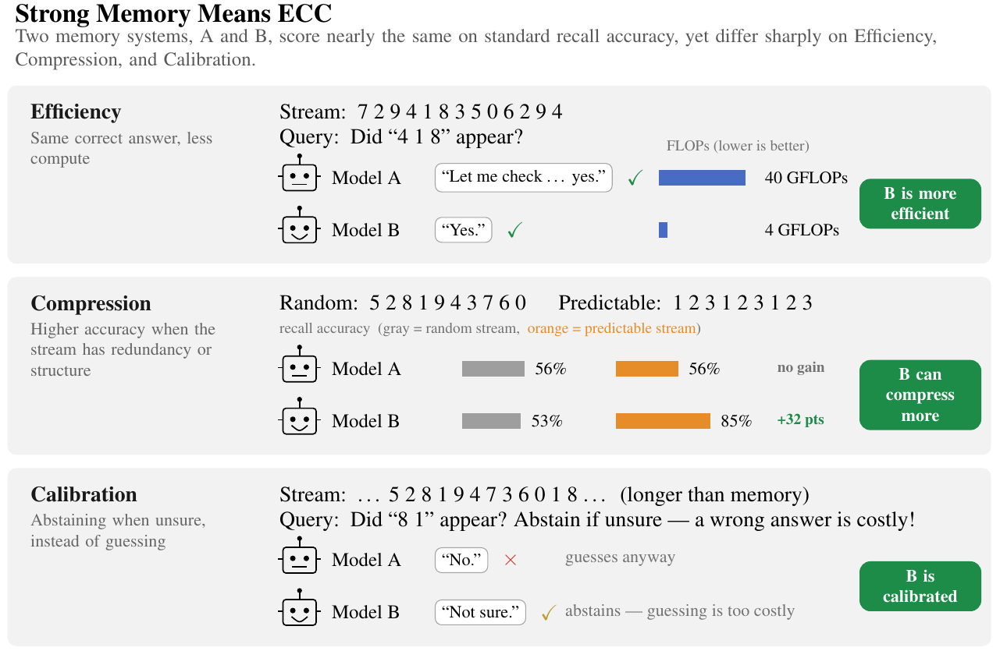

# Good Memory Has ECC: Evaluating the Memory of Vision-Language Models Beyond Accuracy

<p align="center">
  <a href="mailto:sb6870@princeton.edu">Shmuel Berman</a>, <a href="https://www.cs.princeton.edu/~jiadeng/">Jia Deng</a><br>
  Princeton University
</p>

<p align="center">
  <a href="https://arxiv.org/abs/2609.00103"></a>
  <a href="https://huggingface.co/datasets/anonstreammem/substream-recollection"></a>
  <a href="LICENSE"></a>
</p>

<p align="center">
  <a href="#getting-started">Getting Started</a> |
  <a href="https://arxiv.org/abs/2609.00103">Paper</a> |
  <a href="https://huggingface.co/datasets/anonstreammem/substream-recollection">Dataset</a> |
  <a href="#citation">Citation</a>
</p>


*Two memory systems with the same accuracy can nevertheless differ in efficiency, compression and calibration.*

If you use ECCBench, please cite:

```bibtex
@misc{berman2026goodmemoryeccevaluating,
      title={Good Memory Has ECC: Evaluating the Memory of Vision-Language Models Beyond Accuracy}, 
      author={Shmuel Berman and Jia Deng},
      year={2026},
      eprint={2609.00103},
      archivePrefix={arXiv},
      primaryClass={cs.LG},
      url={https://arxiv.org/abs/2609.00103}, 
}
```

## Introduction

Most existing benchmarks and evaluation frameworks measure memory by the accuracy of answers over a long text or video, but accuracy alone does not show if a memory is good!
ECCBench measures capacity, which is the accuracy at a given budget, and three additional properties.
**Efficiency** is the computation, in FLOPs, that a system needs to answer.
**Compression** is whether the system remembers predictable input more accurately or at a lower cost.
**Calibration** is whether the system abstains when it is not sure and an error is costly.
For our task, a model sees a long stream of tokens, synthetic video or natural video.
Then it answers whether a short candidate appeared in the stream.
The synthetic streams have a known entropy, so compression can be measured directly.

This repository contains the evaluation runner, the model wrappers, the synthetic data generator, the memory backbones code, and the FLOPs accounting code from our paper.

## Getting Started

### Install

The code requires Python 3.11.
Create an environment with [uv](https://github.com/astral-sh/uv), or with `conda create -n eccbench python=3.11`:

```bash
git clone https://github.com/princeton-vl/ECCBench.git
cd ECCBench
uv venv -p 3.11 .venv
source .venv/bin/activate
uv pip install -e ".[api]"
```

The `api` extra is sufficient for the API models.
The open models need conflicting library versions, so each group of models has its own extra and its own environment:

| extra | models |
|---|---|
| `full-stack` | Qwen2.5-VL, Qwen3-VL, Qwen3-Omni, GLM-4.5V, InternVL3.5, MiMo-VL, MiniCPM-V 4.5, LongVILA |
| `hf450` | MiniCPM-V 2.6 |
| `hf448` | Phi-4-MM |
| `api` | Claude, all OpenRouter models, the dummy model |
| `backbones` | the memory backbones |

[docs/ENVIRONMENTS.md](docs/ENVIRONMENTS.md) gives the full model and environment information necessary for testing.

### Check the install (CPU, about 1 minute)

The `dummy_eval` model returns fixed answers, and can be used to test the data download, the prompts and the logs without a GPU:

```bash
eccbench-eval --data text --model dummy_eval --mode text --variant sequential \
    --buckets low/L8 --limit 2
```

### Evaluate an open model (GPU)

Create the environment for the model and then run the model in it with `bin/envctl`:

```bash
export ECCBENCH_ENVS_ROOT=$PWD/envs
uv venv -p 3.11 "$ECCBENCH_ENVS_ROOT/eccbench-full-stack"
VIRTUAL_ENV="$ECCBENCH_ENVS_ROOT/eccbench-full-stack" uv pip install -e ".[full-stack]"

bin/envctl run full-stack -- eccbench-eval --data synthetic_video --model qwen_full \
    --mode video --variant sequential --buckets UNIFORM_EVAL_L016_ELOW --limit 1
```

To evaluate the full config, remove `--buckets` and `--limit`.
`--mode text` shows the stream as tokens, and `--mode video` shows it as video.
`--variant sequential` asks only the order questions, and `--variant spatial` asks all questions.
To test calibration, add `--arm A` or `--arm B`; each arm gives a cost for wrong answers ([docs/PROTOCOL.md](docs/PROTOCOL.md)).

### Evaluate an API model

Set the key, then give the OpenRouter model name.

```bash
export OPENROUTER_API_KEY=<your key>
eccbench-eval --data easyhuman --model openrouter \
    --openrouter-model google/gemini-3.1-pro-preview --mode video --variant spatial
```

For Claude through the Anthropic API, set `ANTHROPIC_API_KEY` and use `--model claude-opus-4-7`, for example.
The API models receive every frame but can be blocked if the number of frame is too high.

### Results and resuming

Each run writes two files to `--out` (default `runs/`):

- `<name>.csv` has one row for each question, with the answer, the full response and the token count.
- `<name>.state` records the completed questions.

The default name is `<model>_<data>_<mode>_<variant>`.
To set a different name, use `--name`.
To continue a stopped run, run the same command again with `--resume`.

## The dataset

The dataset is on the Hugging Face Hub at
[`anonstreammem/substream-recollection`](https://huggingface.co/datasets/anonstreammem/substream-recollection).

| config | questions | media | contents |
|---|---|---|---|
| `text` | 7,640 | none | token streams, L = 8 to 4096 |
| `synthetic_video` | 6,065 | 128 MB | the same streams as video, L = 8 to 1024 |
| `natural_video` | 1,726 | 5.2 GB | 1,015 clips from EPIC-Kitchens-100 and SoccerNet, L = 8 to 1024 |
| `easyhuman` | 672 | 10 MB | simple hand-designed patterns, as text and as video |

L is the length of the stream in tokens or frames, and each length is a *bucket*.
Synthetic streams have three entropy bands: `low`, `medium` and `max-entropy`.
Natural clips have a measured density band: `low` or `high`.

You do not need to download the data yourself.
`--data <config>` downloads the question files first.
Then it downloads only the media of the streams that `--buckets` and `--limit` select.
To load the questions yourself:

```python
from datasets import load_dataset

ds = load_dataset("anonstreammem/substream-recollection", "natural_video")["train"]
```

[docs/DATASET.md](docs/DATASET.md) describes the schema of the dataset.

**Licenses.**
The synthetic and EasyHuman data are CC BY 4.0.
The EPIC-Kitchens-100 clips are CC BY-NC 4.0.
The 161 SoccerNet rows are provenance-only: SoccerNet video is under an NDA, so the dataset does not include it.

## Adding a new model

A model is a subclass of `VideoLanguageModelInterface` in `src/eccbench/models/base.py`.
The runner gives the stream to the model with `add_video` or `add_text`.
Then it calls `ask_question`.
The four state methods let the runner reset the context between streams.

```python
# src/eccbench/models/my_model.py
from eccbench.models.base import VideoLanguageModelInterface


class MyModel(VideoLanguageModelInterface):
    def _setup_model(self, max_gpu_mem=None, **kwargs):
        self.context = []  # load the weights for self.model_id here

    def add_video(self, video_frames, time_start, time_end, video_id=None):
        self.context.append(("video", video_frames))  # uint8 tensor (N, 3, H, W)

    def add_text(self, text, current_video_time=0.0):
        self.context.append(("text", text))

    def ask_question(self, question, current_video_time=0.0, max_tokens=256,
                     max_frames_in_video=768, sample_method="TIME"):
        # Run the model on self.context and question. Answer {0}, {1} or {2}.
        return "{2}"

    def get_state(self):
        return {"context": list(self.context)}

    def save_state(self):
        return self.get_state()

    def load_state(self, state):
        self.context = list(state["context"])

    def clear_context(self):
        self.context = []
```

Add an alias to `REGISTRY` in `src/eccbench/registry.py`.
`sampler` selects the frame sampler in `src/eccbench/samplers/`.

```python
"my_model": ModelSpec(
    module="eccbench.models.my_model",
    class_name="MyModel",
    display_name="My Model",
    kind="vlm",
    env="full-stack",
    checkpoint="org/my-model",  # the constructor receives this as model_id
    sampler="qwen_sampler.QwenFrameSampler",
    text_batching=False,
    video_batching=False,
),
```

Batching is off unless the model implements `ask_question_batch_isolated`.

Then run the model:

```bash
eccbench-eval --data text --model my_model --mode text --variant sequential \
    --buckets low/L8 --limit 1
```

## Generating more synthetic data

The generator writes rule-based token streams with a known entropy.
It renders the streams as conveyor-belt videos and writes the questions.
A bucket config sets the length, the entropy range and the number of streams of each bucket.
These commands build one bucket of the released token config (CPU, about 1 minute):

```bash
CONFIG=src/eccbench/generation/configs/bucket_spatial_uniform_eval_tokens.yaml
python -m eccbench.generation.seq2vid.bucket_cli generate --config $CONFIG \
    --out-dir runs_seq --include-buckets UNIFORM_EVAL_L008_ELOW
python -m eccbench.generation.seq2vid.bucket_cli render --config $CONFIG \
    --sequences-root runs_seq --out-dir runs_render --include-buckets UNIFORM_EVAL_L008_ELOW
python -m eccbench.generation.seq2vid.bucket_cli manifest \
    --sequences-manifest runs_seq/bucket_generation_manifest.json
```

To build all buckets, remove `--include-buckets`.
[docs/GENERATION.md](docs/GENERATION.md) explains the stages, the templates and the flags.

## Other experiments

- **Retrieval (RAG).** A Qwen3-VL-Embedding-8B retriever selects windows of each video, and Qwen3-Omni answers from these windows. See [docs/ARCHITECTURES.md](docs/ARCHITECTURES.md).
- **Memory backbones.** Train and evaluate small recurrent, state-space, linear-attention and memory-augmented models on token streams. See [docs/BACKBONES.md](docs/BACKBONES.md).
- **FLOPs.** `eccbench.flops` calculates the analytical FLOPs of each response, with the formulas of Appendix B of the paper. To add a `flops` column to a run log:

  ```bash
  python -m eccbench.flops runs/qwen_full_synthetic_video_video_sequential.csv --model qwen_full
  ```

## Citation

```bibtex
@misc{berman2026goodmemoryeccevaluating,
      title={Good Memory Has ECC: Evaluating the Memory of Vision-Language Models Beyond Accuracy}, 
      author={Shmuel Berman and Jia Deng},
      year={2026},
      eprint={2609.00103},
      archivePrefix={arXiv},
      primaryClass={cs.LG},
      url={https://arxiv.org/abs/2609.00103}, 
}
```

## License

The code is under the MIT license.
Vendored code in `external/` and `src/eccbench/backbones/backend/models/external/` keeps its upstream license; see [THIRD_PARTY_NOTICES.md](THIRD_PARTY_NOTICES.md).
For the dataset licenses, see [The dataset](#the-dataset).
